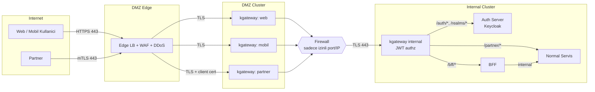

# Bankacılık Kubernetes Platformu — Tasarım Dokümanı

| Alan | Değer |
|---|---|
| Doküman | design.md |
| Versiyon | 0.4 (taslak) |
| Tarih | 2026-11-09 |
| Durum | Onay bekliyor |

---

## 1. Amaç ve Kapsam

Bankanın dış dünyaya açık kanallarını (web, mobil, partner) iç çekirdek servislerinden izole eden, katmanlı bir Kubernetes ortamı tasarlamak.

**Kapsam içinde:**
- 3 katman: DMZ Edge, DMZ Cluster, Internal Cluster
- Gateway katmanı (kgateway), JWT tabanlı yetkilendirme
- Auth server (Keycloak): kimlik doğrulama ve token üretimi
- Ağ izolasyonu, sertifika/sır yönetimi, Kubernetes güvenlik kontrolleri
- Dağıtım (GitOps), gözlemlenebilirlik, yüksek erişilebilirlik

**Kapsam dışında (ayrı doküman):** iş mantığı, veri katmanı (veritabanı, kuyruk) detayları, DR/ikinci lokasyon tasarımı, uygulama API sözleşmeleri.

---

## 2. Tasarım İlkeleri

1. **Derinlemesine savunma:** Her katmanda bağımsız kontrol vardır. Bir katmanın atlatılması diğerini devre dışı bırakmaz.
2. **İnternetten iç cluster'a doğrudan erişim yok.** İç cluster'a yalnızca DMZ cluster'ından, firewall üzerinden, belirli port ve kaynaklarla erişilir.
3. **Sıfır güven (zero trust):** Her hop'ta kimlik doğrulama yapılır. İç ağda "güvenilir" kabul edilen trafik yoktur.
4. **En az yetki (least privilege):** Ağ, RBAC, client yetkileri ve token scope'ları ayrı ayrı daraltılır.
5. **Tek token üreticisi:** Tüm access token'lar iç ağdaki auth server'da üretilir. DMZ hiçbir token üretmez, yalnızca doğrular ve iletir.
6. **Service mesh yok:** Kuzey-güney (dış→iç) trafik kgateway ile yönetilir. Doğu-batı (servisler arası) trafik için NetworkPolicy ve servis bazlı TLS kullanılır.
7. **Pull tabanlı dağıtım:** DMZ'den iç sisteme hiçbir push/bağlantı başlatılmaz. Her cluster kendi GitOps ajanıyla değişiklikleri çeker.

---

## 3. Katman Mimarisi

| Katman | Konum | Görev |
|---|---|---|
| Internet | — | Müşteriler (web, mobil), partnerler |
| DMZ Edge | Ayrı VM/appliance veya cloud WAF | DDoS koruması, WAF, bot filtreleme, L4 filtreleme, public TLS sonlandırma |
| DMZ Cluster | DMZ VLAN | Kanal bazlı gateway'ler (web, mobil, partner), rate limit, token'ın ön doğrulaması (JWKS), şema doğrulama |
| Firewall (iç sınır) | DMZ ↔ İç | Yalnızca tanımlı kaynak/hedef/port izinleri |
| Internal Cluster | İç VLAN | Internal kgateway (JWT authz), auth server (Keycloak), BFF, normal servis |

### 3.1 Mimari Diyagram



---

## 4. Bileşenler

### 4.1 DMZ Edge

- **Görev:** İnternetten gelen trafiğin ilk durağı. Ağ ve uygulama katmanı saldırılarını DMZ cluster'a ulaşmadan filtreler.
- **Yapılacaklar:**
  - DDoS koruması ve rate limit (IP/ASN bazlı)
  - WAF (OWASP Core Rule Set)
  - Host/path bazlı yönlendirme: `web.*` → gw-web, `mobile-api.*` → gw-mobile, `partner-api.*` → gw-partner
  - Public TLS sonlandırma; DMZ cluster'a **yeniden şifrelenmiş (re-encrypt)** TLS ile iletim
  - Partner trafiği için TCP passthrough (mTLS doğrulaması DMZ gateway'de yapılır)
**Bileşenler (üretim önerisi ve lab karşılığı):**

| Katman | Üretim önerisi | Lab (`edge/`) |
|---|---|---|
| Yük dengeleyici ve TLS | HAProxy, iki instance, keepalived (VRRP) ile sanal IP | HAProxy 3.0, tek instance (HA çifti Docker'da test edilemez) |
| WAF | Coraza + OWASP CRS, SPOE ile HAProxy'ye bağlı | coraza-spoa v0.9.1 + CRS |
| L4 DDoS | HAProxy stick-table, kernel SYN cookies, upstream temizleme | stick-table ile IP başına bağlantı sınırı |
| L7 DDoS | HAProxy istek hızı sınırı | stick-table ile IP başına 429 |
| Hacimsel DDoS | ISP veya bulut DDoS servisi, BGP/anycast | Kapsam dışı (simüle edilemez) |

**WAF yaklaşımı:**
- Önce `DetectionOnly` modunda çalışır, yanlış pozitifler ayıklanır, sonra blok moduna geçilir.
- OWASP CRS paranoia seviyesi PL1 ile başlar ve kademeli artırılır.
- Uygulamaya özel istisnalar (ör. ödeme endpoint'i) ayrı kural dosyalarında tanımlanır.
- Her blok olayı correlation ID ile SIEM'e iletilir.
- Hassas veri sızıntısı için yanıt incelemesi (`response_check`) gerektiğinde açılır.

**DDoS yaklaşımı (katmanlı):**
1. **Upstream:** Hacimsel saldırılar (UDP/SYN taşması, bant genişliği tüketimi) edge'de durdurulamaz. ISP veya bulut DDoS servisi BGP/anycast ile temizler.
2. **L4 (edge):** IP başına bağlantı hızı ve eşzamanlı bağlantı sınırı, `maxconn`, kernel SYN cookies.
3. **L7 (edge):** IP başına istek hızı. Mobil kullanıcılar CGNAT arkasında IP paylaştığı için IP limitleri gevşek tutulur. Asıl sınır kullanıcı/oturum bazlı olmalıdır (token'ın `sub` değeri üzerinden, BFF katmanında).
4. **Kimlik uçları:** Login ve OTP endpoint'lerinde ayrı, sıkı limitler (kimlik bilgisi doldurma ve SMS kötüye kullanımı).
5. **Kapasite:** Gateway ve BFF için HPA; backend'ler `maxconn` ve kuyruk sınırıyla korunur.
6. **İzleme ve runbook:** Bağlantı hızı, 429/403 oranı ve SYN backlog izlenir. Eşik aşıldığında upstream temizleme devreye alınır.

### 4.2 DMZ Cluster

**Namespace yapısı:**

| Namespace | İçerik |
|---|---|
| `gw-web` | kgateway (web kanalı) + Gateway/HTTPRoute kaynakları |
| `gw-mobile` | kgateway (mobil kanalı) + Gateway/HTTPRoute kaynakları |
| `gw-partner` | kgateway (partner kanalı) + Gateway/HTTPRoute kaynakları |
| `auth` | DMZ token exchange servisi (ext-authz). Anahtar ve kullanıcı verisi yok, yalnızca iç Keycloak'a exchange istemcisi |
| `platform-system` | cert-manager, External Secrets, Kyverno, Argo CD, monitoring agent'ları |

**Tasarım kararları:**
- **Her kanal için ayrı kgateway instance'ı.** Böylece kanal bazlı izolasyon, ayrı LoadBalancer IP, ayrı rate limit ve ayrı güncelleme penceresi sağlanır. Bir kanaldaki sorun diğerlerini etkilemez.
- **Gateway katmanı görevleri:** TLS (DMZ tarafı), rate limit, şema/boyut kontrolü, access token'ın ön doğrulaması (JWKS ile imza, `exp`, `aud`, `iss`), başarısız istekleri DMZ'de reddetme.
- **DMZ gateway'lerin token sınırları:** Token üretmez ve imzalamaz. Dış token'ı Keycloak'un JWKS'i ile doğrular. İç JWT'yi yalnızca DMZ `auth` servisi üzerinden alır.
- **Login akışı proxy'si:** `/realms/*` yolları DMZ'de yalnızca iletilir (pass-through); kimlik bilgileri DMZ'de işlenmez.
- **Partner gateway ek olarak:** İstemci sertifikası (mTLS) doğrulaması, partner bazlı kota, IP allowlist.

**DMZ `auth` servisi (token exchange):**
- Gateway'lerin ext-authz hedefidir. Dış token'ı alır, iç JWT'ye çevirir ve iç JWT'yi gateway'e döner. Gateway iç isteğe bu JWT'yi `Authorization` başlığı olarak ekler.
- Önbellek: Dış token'ın hash'i anahtarıyla, iç JWT'nin `exp` değerine kadar tutulur. Her istekte exchange yapılmaz.
- Anahtar tutmaz. Her kanal için ayrı exchange istemcisi kullanır (`dmz-exchange-web`, `dmz-exchange-mobile`, `dmz-exchange-partner`), iç Keycloak'a mTLS client cert ile bağlanır.
- Kanal profilini (sender constraint, attestation, IP allowlist) uygular. Profil ayrıntısı için bkz. 5.0.
- Dış token içeriği ve iç JWT'nin üretimi denetim için SIEM'e loglanır.
- Replika: en az 2, PDB ile.

### 4.3 Internal Cluster

**Namespace yapısı:**

| Namespace | İçerik |
|---|---|
| `gw-internal` | kgateway internal (north-south ingress) + JWT authz policy'leri |
| `auth` | Ext-authz (DMZ) ile ayrı. İç cluster'da identity bileşeni yoktur, identity cluster'a bkz. 4.5 |
| `app-bff` | BFF servisi (web ve mobil için) |
| `app-core` | Normal (çekirdek) servis(ler) |
| `platform-system` | cert-manager, External Secrets, Kyverno, Argo CD, monitoring |
| `observability` | Prometheus, Loki/ELK, OpenTelemetry collector |

**Tasarım kararları:**
- **kgateway internal, iç cluster'ın tek giriş noktasıdır.** DMZ'den gelen her istek burada **iç JWT** ile doğrulanır (`iss` = internal realm, `aud` = kgateway-internal). Route bazlı yetkilendirme (scope, audience, HTTP metod, channel, client kimliği) uygulanır. Dış token bu katmana ulaşmaz.
- **BFF**, web/mobil kanalına özel veri birleştirme ve yanıt şekillendirme katmanıdır. Kullanıcı bağlamını taşır, servisleri çağırır.
- **Normal servis**, iş mantığı ve veri erişimini barındırır. Yalnızca BFF ve kgateway internal'dan çağrılabilir (NetworkPolicy ile).
- **Savunma derinliği:** BFF ve normal servis, iç JWT'yi JWKS ile kendileri de doğrular (`iss`, `aud` = kgateway-internal, `exp`, kanal kuralı). Gateway'in doğrulamasına tek başına güvenilmez. Gateway token'ı upstream'e iletir (`forwardToken`). Servisler kanal bilgisini gateway başlıklarından değil, token claim'lerinden alır.

### 4.4 Auth Server (Keycloak)

**Karar (D-4):** Auth server olarak ayrı bir **identity cluster**'da (bkz. 4.5) çalışan **Keycloak** kullanılır. Keycloak, tüm access token'ların ve refresh token'ların tek issuer'ıdır.

**Neden ayrı cluster?** Kullanıcı kimlik bilgileri (parola, OTP secret, MFA kayıtları) ve token imzalama anahtarları iç uygulama ortamından ayrı bir güven bölgesinde tutulur. DMZ yalnızca login isteklerini iletir; kimlik doğrulama identity cluster'da yapılır.

**Dağıtım:**
- Keycloak Operator ile yönetilir (`Keycloak` ve `KeycloakRealmImport` CRD'leri).
- En az **3 replika**, Keycloak'un yerleşik cluster (Infinispan) modu ile.
- Veritabanı: PostgreSQL HA (Patroni veya operator tabanlı), yalnızca `auth` namespace'inden erişilebilir.
- Admin konsolu ve yönetim portu (9000) yalnızca yönetim ağından erişilebilir; DMZ'den ve kullanıcı ağından erişim yoktur.

**Realm modeli (karar):** Tek realm `bank`. Müşteri kullanıcıları, kanal client'ları (web, mobile, partner) ve iç servis client'ları aynı realm'de bulunur. Ayrım client, audience ve client role seviyesinde yapılır. Gerekçe: Keycloak'ta farklı realm'ler arası token exchange standart özelliklerle desteklenmez. Üç realm ayrı tutulursa dış→iç exchange deneysel özellik gerektirir.

| Bileşen | Tür | Amaç |
|---|---|---|
| Müşteri kullanıcıları | Kullanıcılar | Web ve mobil kanalları için kimlik |
| `web-app`, `mobile-app` | Kanal client'ları | Authorization Code + PKCE, DPoP bağlı token |
| `partner-acme` (ve diğer partner'lar) | Kanal client'ı | Client credentials, partner başına bir client |
| `bff`, `core-svc` | İç servis client'ları | Servisler arası client credentials |
| `dmz-exchange-web/mobile/partner` | Exchange client'ları | Her kanal için ayrı; yalnızca kendi kanalının dış token'ını exchange eder |
| `kgateway-internal` | Hedef audience | İç JWT'nin `aud` değeri, `access` client role'ü ile tanımlı |

**Client tanımları:**

| Client | Realm | Tip | Akış | Not |
|---|---|---|---|---|
| `web-app` | customer | Confidential | Authorization Code + PKCE | Web kanalı |
| `mobile-app` | customer | Public | Authorization Code + PKCE | Cihaz bağlama (device binding), kısa refresh ömrü |
| `partner-<id>` | partner | Confidential | Client credentials + mTLS | Partner başına bir client; sertifika bağlı token (RFC 8705) |
| `bff` | internal | Confidential | Client credentials | BFF'in servis kimliği |
| `core-svc` | internal | Confidential | Client credentials | Normal servisin servis kimliği |
| `dmz-exchange-web` | internal | Confidential, mTLS (client cert) | Token exchange (RFC 8693) | Web kanalı. Yalnızca `customer` realm'den `channel=web` token'ı kabul eder |
| `dmz-exchange-mobile` | internal | Confidential, mTLS (client cert) | Token exchange (RFC 8693) | Mobil kanal. Yalnızca `customer` realm'den `channel=mobile` token'ı kabul eder |
| `dmz-exchange-partner` | internal | Confidential, mTLS (client cert) | Token exchange (RFC 8693) | Partner kanalı. Yalnızca `partner` realm'den `channel=partner` token'ı kabul eder |

**Kimlik doğrulama ve MFA:**
- Müşteri girişi: parola + ikinci faktör (OTP veya push onayı; bankanın politikasına göre).
- **Step-up authentication:** Yüksek riskli işlemlerde (ödeme, limit değişikliği vb.) ek doğrulama istenir. Token'daki `acr` claim'i ile BFF ve servis bunu kontrol eder.
- Brute-force koruması ve hesap kilitleme politikası açık.
- Partner kimliği: mTLS (sertifika) + client secret/private key JWT (iki faktörlü, bkz. D-7).

**Token politikası:**

| Parametre | Değer |
|---|---|
| Access token ömrü | 5 dakika (`customer`), 5–10 dakika (`partner`), 5 dakika (`internal`) |
| Refresh token | Her kullanımda rotate edilir; reuse tespitinde tüm oturum iptal edilir |
| İmza algoritması | ES256 veya RS256 |
| Claim'ler | `iss`, `aud`, `sub`, `scope`, `channel` (web/mobile/partner), `acr`, `cnf` (partner için sertifika thumbprint'i) |
| Anahtar rotasyonu | 90 günde bir; eski anahtar, `kid` ile en az bir access token ömrü kadar birlikte yayınlanır |
| Anahtar saklama | İmzalama anahtarları Vault / HSM üzerinde; Keycloak'a dış KMS ile bağlanır |

**Doğrulama modeli (offline):**
- DMZ gateway'ler, kgateway internal ve BFF, Keycloak'un JWKS endpoint'ini (`/realms/<realm>/protocol/openid-connect/certs`) periyodik olarak önbelleğe alır ve token'ları **kendileri** doğrular.
- Her istekte Keycloak'a introspection çağrısı **yapılmaz**. Bu sayede gecikme düşük kalır ve Keycloak'un kısa kesintisi aktif oturumları düşürmez.
- İptal (revocation): Kısa access token ömrü ana mekanizmadır. Kritik işlemler için (ör. hesap kapatma, şüpheli oturum) BFF üzerinden introspection yapılır.

**Dışarıya açılan endpoint'ler (DMZ'den F2 ile geçen):**

| Endpoint | Kaynak | Amaç |
|---|---|---|
| `/.well-known/openid-configuration` | DMZ → iç | Keşif belgesi |
| `/realms/<realm>/protocol/openid-connect/auth` | DMZ → iç | Authorization Code başlatma (login) |
| `/realms/<realm>/protocol/openid-connect/token` | DMZ → iç | Token alma/yenileme |
| `/realms/<realm>/protocol/openid-connect/certs` | DMZ → iç | JWKS (DMZ önbelleği için) |
| `/realms/<realm>/protocol/openid-connect/logout` | DMZ → iç | Oturum kapatma |

Admin konsolu, `/admin/*` ve yönetim portu hiçbir zaman DMZ'ye açılmaz.

**Yüksek erişilebilirlik ve arıza senaryosu:**
- Keycloak tamamen erişilemez olursa mevcut access token'lar ömrü boyunca geçerli kalır; yeni login ve refresh yapılamaz.
- Bu nedenle Keycloak için ayrı SLA, sağlık kontrolleri ve alarm tanımlanır.

**Audit ve izleme:** Login başarı/başarısızlık, MFA olayları, refresh reuse tespiti, admin işlemleri SIEM'e iletilir.

**Partner onboarding:** Partner client'ı ve partner CA'sından çıkan sertifika kaydı, Git üzerinden PR ile GitOps akışında eklenir; manuel konsol değişikliği yapılmaz.

---

### 4.5 Identity Cluster (hedef durum)

**Amaç:** Kimlik ve anahtar yönetiminin tamamı, uygulama ortamından ayrı bir güven bölgesinde. Bu cluster yalnızca internal kgateway üzerinden (F2) erişilir. DMZ'den doğrudan bağlantı yoktur. Yönetim erişimi ayrı bir yönetim ağından (bastion + PAM) yapılır.

**Bileşenler:**

| Bileşen | Namespace | Görev | HA | Not |
|---|---|---|---|---|
| Keycloak | `auth` | Token üretimi, token exchange, login ve MFA akışları. Tek realm `bank` | En az 3 replika, Infinispan | Keycloak Operator ile yönetilir |
| PostgreSQL | `auth-db` | Keycloak veritabanı | Senkron replika, otomatik failover | Şifreli yedek, ayrı konum |
| Vault | **Management cluster'a taşındı** (bkz. 4.6) | Identity'nin sırları Vault'tan türetilir; Keycloak parola ve anahtar yönetimi | 3 node raft, HSM/KMS ile auto-unseal | Anahtarlar dışarı çıkarılamaz |
| PostgreSQL | `auth-db` | Keycloak veritabanı (identity'de kalır, veri sahibi) | Senkron replika | Vault üzerinden kimlik bilgisi |
| MFA sağlayıcı | `mfa` | OTP üretimi ve doğrulama, push onay adaptörü | En az 2 replika | Dış SMS/push servislerine yalnızca izinli FQDN ile çıkış |
| Yönetim araçları | `identity-ops` | Client ve partner onboarding, realm konfigürasyonu | Yönetim ağı | Kod ile (GitOps), manuel konsol değişikliği yok |
| Yedekleme | `backup` | PostgreSQL ve Vault snapshot'ları | — | Şifreli, ayrı lokasyon |

**Ağ kuralları:**
- **Giriş:** Yalnızca internal kgateway'den `/realms/*`, `/.well-known/*`, JWKS ve token exchange uçları. Admin konsolu ve `/admin/*` hiçbir zaman dış erişime açılmaz.
- **Çıkış:** Yalnızca Vault, PostgreSQL (aynı cluster içi), SIEM (syslog/TLS) ve MFA sağlayıcının FQDN allowlist'indeki dış API'leri.
- **DMZ ile:** Doğrudan bağlantı yok. Identity cluster DMZ'ye hiçbir bağlantı başlatmaz.
- **Core banking:** Erişim yok. Identity cluster yalnızca kullanıcı kimliğini tutar, iş verisini tutmaz.

**Güvenlik kontrolleri:**
- Ayrı node pool, ayrı VLAN, en az 3 control plane ve 3 worker.
- API server yalnızca yönetim ağından erişilebilir. RBAC, break-glass hesabı izlenir.
- Keycloak admin erişimi yönetim ağı ve MFA ile sınırlı, admin işlemleri SIEM'e iletilir.
- Vault audit log'u ve Keycloak event log'ları SIEM'e gider.
- Exchange istemcileri (`dmz-exchange-*`) mTLS istemci sertifikası ile kimlik doğrular. Client secret DMZ'ye taşınmaz.
- Partner `cnf` bağlaması için istemci sertifikası kaydı identity cluster'da tutulur.

**Dağıtım ve değişiklik:** GitOps. Realm, client, mapper ve exchange politikaları kod olarak tutulur. Değişiklik PR ile, iki onayla yapılır.

**Yedekleme ve DR:** PostgreSQL ve Vault snapshot'ları şifreli olarak ikinci lokasyona gider (D-8). Anahtar replikasyonu HSM üzerinden yapılır, anahtar metni hiçbir zaman açık olarak taşınmaz.

**Kapsam dışı:** BFF, normal servis ve iç kgateway (internal cluster), ext-authz (DMZ cluster).

---

### 4.6 Management / Secrets Cluster (hedef durum)

**Amaç:** Vault ve yönetim araçlarını (Argo CD, Kyverno, PKI) identity ve uygulama ortamlarından ayırmak. Vault birden fazla sistemin ortak secret kaynağı. Keycloak ile aynı cluster'da olursa Keycloak'a yapılan bir saldırı Vault'a da yaklaşır. Ayrı cluster bu sınırı çizer.

**Bileşenler:**

| Bileşen | Namespace | Görev | HA | Not |
|---|---|---|---|---|
| Vault | `secrets` | KV v2 (parolalar, sırlar), PKI (mTLS sertifikaları), Kubernetes auth | 3 node raft, HSM/KMS auto-unseal | Lab: tek düğüm, emptyDir |
| Argo CD | `gitops` | Üç cluster'ı (DMZ, internal, identity) pull ile yönetir | HA | Her cluster'ın kendi ajanı, merkezi yönetim |
| Kyverno | `policy` | Admission politikaları (imaj registry, imza, privileged yasağı) | HA | Tüm cluster'lar için politika kaynağı |
| Yönetim araçları | `ops` | Yedekleme koordinasyonu, sertifika rotasyonu | — | Yalnız yönetim ağı |

**Erişim (F9):**
- Identity ve internal cluster'lar Vault'a yalnız F9 üzerinden bağlanır (TCP 8200, prod'da mTLS). Kimlik doğrulama Kubernetes auth ile, her workload kendi politikasıyla.
- DMZ cluster'ı Vault'a doğrudan bağlanmaz. DMZ'nin sertifikaları iç ağ üzerinden, ayrı bir yenileme ajanıyla alınır.
- Management cluster'ın API sunucusu ve admin erişimi yalnız yönetim ağından, bastion + PAM ve MFA ile.

**Vault kullanım alanları (hedef):**
- Keycloak parolaları ve DB kimlik bilgileri (identity cluster, ESO ile).
- Exchange, DMZ ve partner istemci sertifikaları (Vault PKI, kısa ömürlü).
- Realm imzalama anahtarları (D-12 kararına bağlı: HSM/KMS veya Transit tabanlı imzalama).
- Servis kimlik bilgileri (BFF, core, ileride DB kullanıcıları için dinamik secret).

**Yedekleme ve DR:** Vault snapshot'ları ve raft yedekleri şifreli, ikinci lokasyonda. Unseal anahtarları paylaşılmış (Shamir) ya da HSM/KMS ile auto-unseal.

**Lab sapmaları:** tek Vault düğümü, emptyDir (her yeniden başlatmada yeniden init), TLS kapalı, unseal anahtarı ve root token mgmt cluster'da bir secret içinde, identity secret'ları host üzerinden türetiliyor. Prod'da bunların hepsi yukarıdaki hedef tasarıma göre değişir (bkz. 15.2).

---

## 5. Trafik Akışları

### 5.0a Route Sınıfları

Her DMZ gateway'inde path'ler üç sınıfa ayrılır. Kimlik kontrolü yalnızca sınıfa göre uygulanır:

| Sınıf | Path | Kimlik (ext-authz) | Kısıtlar | Lab karşılığı |
|---|---|---|---|---|
| **public** | `/public/*` | Yok | Yalnızca GET, IP bazlı sıkı rate limit, cache'lenebilir yanıt, kişiye özel veri yok | `web-public`, `mobile-public` |
| **login** | `/realms/*`, `/.well-known/*` | Yok (token'ı bu uçlar üretir) | Login ve OTP için sıkı rate limit, bot koruması, partner için mTLS gateway'de | `web-login`, `mobile-login`, `partner-login` |
| **api** | Diğer her şey | Zorunlu: dış token + iç JWT | Route bazlı yetki, kanal kontrolü | `web`, `mobile`, `partner` (TrafficPolicy ile ext-authz) |

**İç kgateway tarafı:** Public path'ler iç ağa da ulaşır, bu yüzden iç kgateway'de ayrı bir route sınıfı tanımlanır. Varsayılan red (default deny) kuralı korunur. Yalnızca açıkça listelenen public path'ler JWT olmadan geçer. Bu istekler yalnızca DMZ gateway kimliğinden (mTLS) kabul edilir.

**Uygulama notu:** Gateway API'de `TrafficPolicy` bir `HTTPRoute`'a bağlanır. Bu nedenle sınıflar ayrı `HTTPRoute` kaynakları olarak tanımlanır. Gateway en uzun path eşleşmesini seçer.

### 5.0b Mobil Token Exchange: Bulgular ve Karar

**Bulgu:** Keycloak 26.6, DPoP'a bağlı (`cnf`) subject token'larının token exchange'de kullanılmasını kabul etmiyor:
`Sender-constrained tokens (RFC 7800) cannot be used as subject_token in Token Exchange`. Partner token'ları bu kısıtlamadan etkilenmiyor. **Web token'ları:** İlk yapılandırmada `web-app` DPoP bağlı token üretiyordu ve bu token exchange'de 400 ile reddediliyordu (ölçüm: `Sender-constrained tokens are not supported as subject_token`). Karar: web akışı DPoP'suz (PKCE + Bearer), mobil akışı DPoP'lu (SPI). Böylece web token'ları exchange'den geçer. D-10 (web için DPoP) prod'da yeniden değerlendirilmelidir. Mobil token'lar DPoP ile bağlandığı için mobil iç çağrılar şu an başarısız (güvenli taraftan başarısızlık).

**Denenen çözüm (impersonation):** DMZ, DPoP'u kendisi doğrular, sonra mTLS ile kimliği belli `dmz-exchange-mobile` client'ı üzerinden kullanıcı adına impersonation ile iç token alır. Sonuç: başarısız.
- Standard Token Exchange V2 `requested_subject` parametresini desteklemiyor (`Parameter 'requested_subject' is not supported for standard token exchange`).
- Eski (V1) token exchange ve fine-grained admin özellikleri açıldığında kullanıcı yönetim izni uç noktaları bu yapılandırmada 404/501 döndü. Impersonation izni verilemedi.
- Deneme sonrası ek özellikler kapatıldı. Identity cluster preview özellik içermiyor.

**Mevcut durum:**
- DMZ ext-authz mobil isteklerde DPoP proof'unu henüz doğrulamıyor. Yalnızca dış token'ın RS256 imzasını kontrol ediyor.
- Mobil token exchange başarısız olduğu için mobil iç çağrılar kapalı. Yetkisiz erişim olmaz, ama mobil akış çalışmaz.

**Önerilen yol (D-11):**
1. **DMZ'de DPoP proof doğrulaması** (RFC 9449, bölüm 4.3). **Uygulandı (lab):** Token `cnf.jkt` içeriyorsa veya kanal mobile ise, ext-authz proof imzasını (proof içindeki `jwk`), `htm`, `htu`, `iat` tazeliğini (5 dk geçmiş, 1 dk gelecek toleransı), `jti` tekrarını, `ath` = base64url(SHA-256(access_token)) ve `cnf.jkt` = jwk thumbprint (RFC 7638) ile kontrol eder. Test: `dmz-cluster/tests/extauth.sh` (4a–4f). Lab sınırları: yalnızca RS256 proof (ES256 için kriptografi kütüphanesi gerekir); `jti` cache'i süreç içidir, bu yüzden ext-authz tek replikada çalışır. Üretimde jti store'u paylaşılan olmalıdır.
2. **Keycloak'ta mobil için özel token exchange SPI:** Yalnızca mTLS ile kimliği doğrulanmış `dmz-exchange-mobile` isteğinde, DPoP'a bağlı subject token'ı kabul eder. Güven DMZ'nin proof doğrulamasına dayanır, SPI kanal ve `cnf` eşleşmesini tekrar kontrol eder. Keycloak yükseltmelerinde SPI yeniden test edilir.

**Karar ve uygulama (D-11, uygulandı):** Önerilen yol uygulandı. DMZ ext-authz DPoP proof'unu doğrular. Keycloak'ta `dmz-dpop-mobile-exchange` SPI'si, DMZ mobil exchange'inde (mTLS ile kimliği doğrulanmış `dmz-exchange-mobile`) subject token'ı Keycloak anahtarıyla bağlamasız olarak yeniden imzalar, sonra standart exchange çalışır. Test: `dmz-cluster/tests/extauth.sh` (mobil `200`, `channel=mobile`, `auth_method=dpop_device`) ve `internal-cluster/tests/authz.sh`. Kaynak ve sınırlar: `identity-cluster/keycloak-spi/README.md`. Güven modeli: DMZ DPoP doğrulamasına ve mTLS kimliğine dayanır. Standart exchange'in DPoP'a bağlı token'ları reddetmesi bu SPI ile bilinçli olarak aşılmıştır, bu yüzden Keycloak yükseltmelerinde yeniden gözden geçirilmelidir.

**SPI fizibilite bulgusu (Keycloak 26.6.4):** Extension noktası `TokenExchangeProvider` / `TokenExchangeProviderFactory`. Sender-constrained kontrolü `StandardTokenExchangeProvider.tokenExchange()` içinde, private `isSenderConstrainedToken` ile yapılıyor. Kontrolü atlamak için token üretim akışının (imzalama, session, audience ve scope işleme) yeniden yazılması gerekir. Bu, güvenlik açısından kritik ve iç API'lere bağımlı bir değişiklik. SPI yolu teknik olarak mümkün, ama bakım maliyeti yüksek. Karar henüz verilmedi.

**Alternatif (risk kabulü gerektirir):** Mobil token'ı DPoP'suz vermek. Çalınan token başka cihazda kullanılabilir. Tasarımın D-10 kararına aykırıdır.

### 5.0 Kanal Güvenlik Profilleri

Her kanalın kimlik doğrulama ve token bağlama modeli farklıdır. Bu farklar DMZ'deki exchange noktasında uygulanır. İç ağ tek bir iç JWT formatı görür.

| Kanal | Kimlik doğrulama | Token bağlama (sender constraint) | Ek kontroller | Exchange istemcisi |
|---|---|---|---|---|
| Web | OIDC Authorization Code + PKCE, MFA (OTP/push) | DPoP (RFC 9449), D-10 kararına bağlı | CSRF koruması, step-up (`acr`) | `dmz-exchange-web` |
| Mobil | OIDC Authorization Code + PKCE (public client) | DPoP zorunlu | Cihaz attestation (App Attest / Play Integrity), device binding, refresh rotate | `dmz-exchange-mobile` |
| Partner | Client credentials | mTLS sertifika bağlama (`cnf`, RFC 8705) zorunlu | IP allowlist, partner başına scope, kota | `dmz-exchange-partner` |

**Exchange kuralları (DMZ `auth`):**
- Her exchange istemcisi yalnızca kendi kanalının dış token'ını exchange edebilir. Örnek: `dmz-exchange-mobile`, yalnızca `customer` realm'den `channel=mobile` token'ı kabul eder.
- Sender constraint doğrulanır (DPoP proof veya `cnf` eşleşmesi). Yalnızca doğrulanmış sonuç iç JWT'ye yazılır.
- İç JWT kanal bağımsız bir yapıdadır: `iss`, `aud`, `sub`, `channel`, `auth_method` (`pwd_otp`, `dpop_device`, `mtls_partner`), `acr`, `scope`, opsiyonel `partner_id`.
- Kanal bazlı yetki farkları iç yetkilendirmede `channel` ve `auth_method` claim'leriyle yapılır. İç servisler kanala özel kriptografi bilmez.

### 5.1 Web / Mobil

**A. Giriş (bir kez, Authorization Code + PKCE):**

```
1. Kullanıcı → Edge             HTTPS 443, WAF + DDoS kontrolü
2. Edge → gw-web / gw-mobile    TLS (re-encrypt), host/path yönlendirme
3. gw-web / gw-mobile           /realms/customer/* yolu pass-through (rate limit uygulanır)
4. → kgateway internal → Keycloak   Login, MFA, PKCE doğrulaması
5. Keycloak → kullanıcı         Access token (5 dk, aud=bff, channel=web) + refresh token
```

**B. İşlem çağrısı (her API isteğinde):**

```
1. Kullanıcı → Edge             HTTPS 443, Authorization: Bearer <dış token>
2. Edge → gw-web / gw-mobile    TLS (re-encrypt), host/path yönlendirme
3. gw-web / gw-mobile           Rate limit, şema kontrolü, dış token'ı JWKS ile doğrula (imza, iss, aud, exp)
4. gw-web → DMZ auth (ext-authz) Dış token'ı ilet. Önbellekte iç JWT varsa 6'ya geç
5. DMZ auth → iç Keycloak       Token exchange (RFC 8693, F3): dış token → iç JWT (aud=kgateway-internal, channel, sub, scope)
6. DMZ auth → gw-web            İç JWT'yi döndür (önbellek: iç JWT'nin exp'i kadar)
7. gw-web → kgateway internal   Authorization: Bearer <iç JWT> (F2). Dış token iç ağa gitmez
8. kgateway internal            İç JWT doğrulama (iss, aud, exp, imza) + route authz (scope, channel, metod)
9. kgateway internal → BFF      TLS, iç JWT ile
10. BFF → normal servis         TLS. Kullanıcı bağlamı iç JWT'den; gerekirse servis için ayrı exchange (aud=core)
11. Normal servis               İç JWT doğrulama + iş kuralı yetkisi (sahiplik, limit vb.)
```

**Token refresh:** Access token süresi dolunca istemci refresh token ile `/token` endpoint'ine gider (gw-web → kgateway internal → Keycloak). Yeni access token üretilir.

### 5.2 Partner

**A. Token alma (client credentials + mTLS):**

```
1. Partner → Edge               mTLS 443 (TCP passthrough)
2. Edge → gw-partner            TLS + client cert
3. gw-partner                   Client cert doğrulama (partner CA), kota
4. gw-partner → kgateway int.   /realms/partner/.../token (F2)
5. Keycloak → partner           Access token (5–10 dk, cnf = sertifika thumbprint'i)
```

**B. API çağrısı:**

```
1. Partner → Edge               mTLS 443 (TCP passthrough)
2. Edge → gw-partner            TLS + client cert
3. gw-partner                   Client cert doğrulama (partner CA), cnf eşleşmesi, dış token JWKS ile, kota
4. gw-partner → DMZ auth        Dış token'ı ilet (önbellekte iç JWT yoksa exchange)
5. DMZ auth → iç Keycloak       Token exchange (F3): dış token → iç JWT (aud=kgateway-internal, channel=partner, partner_id)
6. gw-partner → kgateway int.   Authorization: Bearer <iç JWT> (F2)
7. kgateway internal            İç JWT doğrulama, partner route'ları için scope kontrolü
8. kgateway internal → Core     /partner/* route'ları normal servise gider      [D-2]
9. Normal servis                Partner'a özel iş kuralı (hesap/sözleşme yetkisi)

**Not:** Partner'ın mTLS sertifika bağlaması (`cnf`) DMZ'de doğrulanır. İç JWT bu bağlamayı taşımaz, güven DMZ→iç mTLS bağlantısına dayanır. Bu kabul edilen bir risktir (bkz. 13).

**Kanal farkları:** Web ve mobil akışlarında exchange öncesi DMZ, kanal profilini uygular (bkz. 5.0). Web'de DPoP kararına (D-10) göre, mobilde DPoP ve cihaz attestation zorunludur. Partner akışında exchange öncesi `cnf` eşleşmesi zorunludur. İç JWT'de her kanal için `channel` ve `auth_method` farklı değerler taşır.
```

### 5.3 Token Modeli

| Token | Üreten | Kullanan | Doğrulayan | Ömür |
|---|---|---|---|---|
| Dış access token (customer) | Keycloak (`customer`), aud=kanal | Web, mobil | gw-web/gw-mobile (JWKS), DMZ auth | 5 dk |
| Dış access token (partner) | Keycloak (`partner`), aud=kanal, `cnf` | Partner | gw-partner (JWKS, cnf), DMZ auth | 5–10 dk |
| Dış refresh token | Keycloak (`customer`) | Web, mobil | Sadece Keycloak | Her kullanımda rotate |
| **İç JWT** | Keycloak (`internal`), token exchange ile | DMZ gateway → kgateway internal → BFF / servis | kgateway int., BFF, normal servis (JWKS) | 1–5 dk |
| Servis token'ı | Keycloak (`internal`), client credentials | BFF, normal servis | kgateway int., normal servis | 5 dk |

**İlkeler:**
- **İç token dışarı verilmez:** Dış istemciden gelen her kimlik doğrulama DMZ'de iç token'a çevrilir. İç token yalnızca DMZ→iç bağlantıda ve iç ağda dolaşır. Hiçbir istemci yanıtında, yanıt başlığında, yanıt gövdesinde veya DMZ stub/backend'ine iletilen istekte bulunmaz. DMZ'de tanımlı olmayan yollar iç token üretilmeden 404 ile reddedilir (default deny).
- **İki ayrı token, iki ayrı issuer kuralı:** Dış token yalnızca DMZ'de doğrulanır ve iç ağa geçmez. İç ağda yalnızca iç JWT dolaşır.
- **Dönüşüm yalnızca DMZ `auth` servisinde** yapılır (RFC 8693). DMZ hiçbir anahtar imzalamaz; iç JWT iç Keycloak'ta imzalanır.
- İç JWT claim'leri: `iss` (internal realm), `aud` (`kgateway-internal`, `bff`, `core`), `sub`, `scope`, `channel` (web/mobile/partner), `auth_method` (`pwd_otp`, `dpop_device`, `mtls_partner`), `acr`, `partner_id` (partner için).
- Her katman, kendi token'ını offline JWKS ile doğrular. Güven, ağ konumuna değil iç JWT'ye dayanır.
- Kısa ömür ve `kid` ile anahtar rotasyonu. JWKS, Keycloak'un standart endpoint'inden yayınlanır.

### 5.4 Yetkilendirme Modeli

- **kgateway internal (kaba taneli):** Route, HTTP metod, `aud`, `scope`, `channel`, `cnf` (partner) ve client kimliği.
- **BFF (kanal kuralları):** Hangi kanal hangi kullanıcı işlemini çağırabilir; step-up gereken işlemlerde `acr` kontrolü.
- **Normal servis (ince taneli):** Hesap sahipliği, limit, iş kuralı. Kgateway bu kontrolü yerine geçmez.

---

## 6. Ağ Tasarımı

### 6.1 Genel Kurallar
- Her namespace için **default deny** ingress ve egress NetworkPolicy.
- CNI: **Cilium** (L3/L4 ve gerektiğinde L7 policy, Hubble ile görünürlük) veya Calico. (D-6)
- Pod CIDR, Service CIDR ve node ağları iki cluster'da **çakışmayacak** şekilde planlanır ve kurumsal IPAM'de kayıt altına alınır.
- DNS: İç cluster DNS'i DMZ'ye açılmaz. DMZ, gerekli isimleri ya da yalnızca kgateway internal'ın VIP'ini kendi DNS'inde tanımlar.

### 6.2 İzin Verilen Akışlar (Firewall Matrisi)

| # | Kaynak | Hedef | Port/Protokol | Amaç | Yön |
|---|---|---|---|---|---|
| F1 | Edge | gw-web, gw-mobile, gw-partner | TCP 443 (lab: NodePort 30446–30448, yalnız edge IP'si) | Public giriş | Edge → DMZ |
| F2 | gw-web, gw-mobile, gw-partner | kgateway internal | TCP 443 (TLS) | API çağrıları, login/token endpoint'leri | DMZ → İç |
| F3 | DMZ `auth` servisi | Iç Keycloak token endpoint (kgateway internal üzerinden) | TCP 443 (mTLS) | Token exchange (RFC 8693), JWKS önbellek yenileme | DMZ → İç |
| F4 | Internal cluster | DMZ | — | **Yasak** (başlatılan bağlantı yok) | İç → DMZ |
| F5 | DMZ | Internal DB/servis/Keycloak admin | — | **Yasak** (yalnızca F2/F3 üzerinden) | DMZ → İç |
| F6 | Tüm DMZ ve iç cluster | Git / registry | Yalnızca pull, onaylı transfer | GitOps, image | Tek yönlü |
| F7 | Tüm cluster'lar | Log/SIEM | Syslog/TLS | Gözlem | Tek yönlü |
| F8 | kgateway internal (iç cluster) | Identity cluster (Keycloak) | TCP 443 (mTLS) | `/realms/*`, `/.well-known/*`, JWKS, token exchange | İç → Identity |
| F9 | Identity ve iç cluster'lar | Management cluster (Vault API) | TCP 8200 (mTLS, prod) | Secret okuma, PKI sertifika üretimi (Kubernetes auth ile) | Identity/İç → Mgmt |

Not: F4 ve F5 kuralları "yasak" olarak firewall'da açıkça tanımlanır (default deny). F3, F2 içinde yönlendirilebilir; ayrı port gerekmez.

### 6.3 Kubernetes NetworkPolicy Özeti (İç Cluster)

| Hedef namespace | İzin verilen kaynak |
|---|---|
| `gw-internal` | DMZ gateway pod'ları ve DMZ ext-authz. Firewall üzerinden (IP/label bazlı), iç CA'dan imzalı DMZ istemci sertifikası (mTLS) zorunlu |
| `app-bff` | `gw-internal` |
| `app-core` | `app-bff`, `gw-internal` (yalnızca `/partner/*` ve `/public/*` yolları için) |

**Identity cluster'a giden akış (F8):** İç cluster'dan yalnızca `gw-internal` identity cluster'a bağlanır. İzinli yollar `/realms/*`, `/.well-known/*`, JWKS ve token exchange uçlarıdır. Bağlantı mTLS ile yapılır. Identity cluster'daki Keycloak'un DB bağlantısı (PostgreSQL) yalnızca `auth-db` namespace'inden kabul edilir (bkz. 4.5).

---

## 7. Kimlik, Sertifika ve Sır Yönetimi

- **Sertifika:** cert-manager + bankanın internal CA'sı (PKI). Gateway TLS sertifikaları ve servis sertifikaları **en fazla 90 gün**, otomatik yenilenir.
- **Partner CA:** Partner istemci sertifikaları ayrı bir CA'dan çıkar; gw-partner yalnızca bu CA'yı güvenir.
- **Sır (secret) yönetimi:** HashiCorp Vault (veya kurumsal KMS) + External Secrets Operator. Git'te düz `Secret` **bulunmaz**. Keycloak admin ve DB şifreleri Vault'ta tutulur.
- **JWT imzalama anahtarları:** Vault/HSM'de tutulur, 90 günde bir rotate edilir (bkz. 4.4).
- **etcd:** Şifreleme at rest açık.

---

## 8. Kubernetes Güvenlik Kontrolleri

| Kontrol | Uygulama |
|---|---|
| Pod Security | Uygulama namespace'leri `restricted`; gateway ve auth namespace'leri gerekirse `baseline` |
| Admission control | Kyverno: imaj registry allowlist, imza doğrulama (cosign), privileged yasağı, resource limit zorunluluğu, zorunlu label'lar |
| Image güvenliği | CI'da Trivy/Grype tarama; kritik açık olan imaj deploy edilmez |
| RBAC | İnsan kullanıcılar için cluster-admin yok; rol bazlı erişim; break-glass hesabı izlenir |
| Node | CIS benchmark'a uygun hardened OS; DMZ ve iç için ayrı node pool'lar (taint/toleration ile) |
| API server | Audit logging açık, loglar SIEM'e iletilir |
| Workload | `runAsNonRoot`, `readOnlyRootFilesystem`, seccomp `RuntimeDefault`, `automountServiceAccountToken: false` (gerekmedikçe) |
| Anonim erişim | Kapalı; API server'a erişim yalnızca yönetim ağından |

---

## 9. Dağıtım (GitOps) ve Ortamlar

- **Git:** Kurumsal Git sunucusu (iç ağda). Manifest'ler, Helm chart'lar ve Keycloak realm/client tanımları burada tutulur.
- **Argo CD:** Her cluster'da kendi ajanı. İç Argo CD iç cluster'ı, DMZ Argo CD'si DMZ cluster'ı yönetir.
- **DMZ'ye veri aktarımı (F6):** Manifest ve image'lar, onaylı tek yönlü transfer ile DMZ'deki mirror'a (Git mirror + registry replica) aktarılır. DMZ'den iç sisteme bağlantı açılmaz.
- **Ortamlar:** `staging` ve `prod`. Her ortamın kendi DMZ ve iç cluster'ı olur. Geliştirme ortamı izole bir test kümesidir.
- **Değişiklik süreci:** Pull request + en az iki onay + otomatik policy kontrolü (Kyverno/Conftest) + prod'a manuel onaylı sync.
- **Keycloak yapılandırması:** Realm ve client'lar kod olarak (`KeycloakRealmImport`) tutulur; konsoldan manuel değişiklik yapılmaz.

---

## 10. Gözlemlenebilirlik

- **Metrik:** Her cluster'da Prometheus; merkezi Grafana (iç ağda).
- **Log:** Loki veya ELK; kgateway erişim logları, Keycloak event logları ve uygulama logları. 401/403 logları ayrıca izlenir.
- **Trace:** OpenTelemetry; kgateway'den BFF ve servislere `traceparent` yayılımı.
- **Correlation ID:** Edge'de üretilir, tüm katmanlarda taşınır.
- **Uyarılar:** Anormal 401/403 artışı, JWT doğrulama hatası oranı, gateway 5xx, Keycloak login hata oranı ve gecikmesi, refresh token reuse tespiti, sertifika süresi dolmak üzere, JWKS yenileme hatası.
- **Güvenlik olayları:** Admission reddi, RBAC ihlali, beklenmeyen ağ bağlantısı (Cilium/Hubble), Keycloak admin işlemleri SIEM'e gider.

---

## 11. Yüksek Erişilebilirlik ve Kapasite

- Her cluster: en az **3 control plane** düğümü, en az **3 worker** düğümü, farklı rack/zone'larda.
- kgateway: kanal başına en az **2 replika**, `PodDisruptionBudget`, HPA (CPU/RPS bazlı).
- Keycloak: en az **3 replika**, PDB, zone'lara dağıtılmış; PostgreSQL HA (senkron replika + otomatik failover).
- BFF ve normal servis: en az 2 replika, topology spread constraints ile zone dağılımı.
- Gateway LB: DMZ ve iç için ayrı, yük dengeleyici sağlık kontrolleri açık.

---

## 12. Kararlar ve Açık Sorular

Aşağıdaki maddeler onay bekler. Varsayılan öneri her madde için verilmiştir.

| # | Konu | Varsayılan öneri | Alternatif |
|---|---|---|---|
| D-1 | Token modeli | **İki token + DMZ'de token exchange (RFC 8693).** Dış token DMZ'de doğrulanır, DMZ `auth` servisi iç Keycloak'tan iç JWT alır. İç yetkilendirme iç JWT ile yapılır. | Dış token'ı aynen iç ağa iletmek: dış token iç ağa girer, iç doğrulama dış issuer'a bağlanır. Reddedildi. |
| D-2 | Partner istekleri nereye gider? | **Doğrudan normal servis** (`/partner/*`), BFF yalnızca web/mobil için. | Partner de BFF üzerinden geçer (tek giriş, daha fazla katman). |
| D-3 | Edge ürünü | **HAProxy** (LB, TLS, L4/L7 rate limit) + **Coraza WAF** (OWASP CRS) + upstream DDoS temizleme (ISP veya bulut) | F5 BIG-IP (LTM + ASM + AFM) veya cloud WAF. Aynı katmanı karşılar; lisans ve işletim maliyeti farklı |
| D-4 | Auth server | **Keycloak** (Operator ile, ayrı identity cluster, 3 replika, HA PostgreSQL, Vault/HSM ile anahtar yönetimi) | Bankanın mevcut merkezi IdP'si (varsa) veya ticari IdP |
| D-5 | Kubernetes dağıtımı | **RKE2** veya **OpenShift** (kurumsal destek ve güvenlik sertleştirmesi için) | Vanilla kubeadm (daha fazla kendi sorumluluk) |
| D-6 | CNI | **Cilium** (L7 policy, Hubble) | Calico |
| D-7 | Partner kimlik modeli | **mTLS + client credentials** (sertifika bağlı token, `cnf`) | Yalnızca client secret (daha zayıf) |
| D-8 | İkinci lokasyon / DR | Ayrı doküman; bu tasarımda aktif-pasif öneri | Aktif-aktif (karmaşıklık yüksek) |
| D-9 | Müşteri MFA yöntemi | **OTP + push onayı** (Keycloak'ta yapılandırılır) | Donanım token (FIDO2/WebAuthn) — daha güçlü, daha pahalı |
| D-10 | Web sender constraint | **DPoP önerilir** (access token cihaz/tarayıcı anahtarına bağlı). Mobil için DPoP zorunlu | Web için yalnızca bearer + kısa ömür (daha basit, daha zayıf) |
| D-11 | Mobil token exchange (DPoP'lu token) | **DMZ'de DPoP proof doğrulaması + mobil için Keycloak token exchange SPI'si** (bkz. 5.0b) | DPoP'u kaldırmak (risk kabulü) veya mobil için farklı kimlik modeli |

---

## 13. Riskler

| Risk | Etki | Azaltma |
|---|---|---|
| Service mesh olmaması nedeniyle servisler arası mTLS otomatik değil | Doğu-batı trafikte şifreleme ve kimlik boşluğu | Kritik servislerde servis bazlı TLS (cert-manager); NetworkPolicy ile erişim daraltma; token'ın servis seviyesinde yeniden doğrulanması |
| kgateway tek giriş noktası | Gateway arızası tüm kanalları etkiler | Kanal bazlı ayrı instance'lar, çok replika, PDB, sağlık kontrolleri |
| Keycloak arızası | Yeni login ve refresh yapılamaz | HA (3 replika, HA PostgreSQL), ayrı SLA, access token ömrü kadar mevcut oturumlar devam eder |
| Keycloak ele geçirilmesi | Tüm token'ların sahteciliği | Anahtarların Vault/HSM'de tutulması, admin erişiminin yönetim ağıyla sınırlanması, MFA'lı admin girişi, admin olaylarının SIEM'e iletilmesi |
| Token iptalinin gecikmesi | Çalınmış access token kısa süre geçerli kalır | 5 dk'lık access token ömrü; kritik işlemlerde introspection; refresh reuse tespiti |
| DMZ `dmz-exchange` istemci kimliğinin ele geçirilmesi | DMZ'den sahte iç JWT üretimi (DMZ'den iç yetkiye geçiş) | İstemci yalnızca exchange izni ve kanal audience'ları ile sınırlı; mTLS client cert kısa ömürlü ve workload'a bağlı; exchange olayları SIEM'de; hız sınırı ve anomali uyarısı |
| Token exchange gecikmesi ve iç Keycloak bağımlılığı | Yeni oturumlar gecikir veya düşer | İç JWT `exp`'ine kadar önbellek; DMZ `auth` en az 2 replika; Keycloak SLA |
| Kanallar arası güvenlik seviyesi tutarsızlığı | Bir kanal zayıf sender constraint ile geçebilir | Kanal profili tek tabloda (5.0); kanal başına exchange istemcisi; exchange politikası kod olarak (GitOps) ve test ile doğrulanır |
| Mobil cihazın ele geçirilmesi veya klonlanması | Çalınmış dış token başka cihazda kullanılır | DPoP (cihaz anahtarına bağlı token), cihaz attestation, kısa access token ömrü, refresh rotate ve reuse tespiti |
| Partner `cnf` bağlamasının iç ağda taşınmaması | İç servis sertifika bağlamasını doğrulayamaz | DMZ→iç mTLS ile güven; `partner_id` ve `channel` claim'leri; iç servis yalnızca gw-partner kimliğinden çağrı kabul eder |
| kgateway olgunluğu ve bankacılık düzeyinde destek | Destek ve güncelleme riski | Sürüm politikası, ticari destek veya Gateway API uyumlu alternatiflerin değerlendirilmesi (D-5 ile birlikte) |
| DMZ–iç ayrımının yanlış yapılandırılması | Kritik veriye yanlış erişim | Firewall + NetworkPolicy çift katmanlı; periyodik ağ politika denetimi ve sızma testi |
| Tek yönlü transfer gecikmesi | Güvenlik yaması DMZ'ye geç ulaşır | Onaylı transfer süreci için SLA; kritik yamalarda hızlandırılmış yol |

---

## 14. Uygulama Fazları

1. **Faz 0 — Kararlar:** D-1 ile D-9 arasındaki maddelerin onayı, IP/CIDR planı, sertifika PKI'si.
2. **Faz 1 — Temel altyapı:** İki cluster kurulumu, CNI, cert-manager, Vault/ESO, Kyverno, Argo CD, monitoring.
3. **Faz 2 — Ağ:** Firewall kuralları (F1–F7), default deny NetworkPolicy, DNS ayrımı.
4. **Faz 3 — Auth server:** PostgreSQL HA, Keycloak Operator kurulumu, realm'ler (`customer`, `partner`, `internal`), client tanımları, MFA ve token politikaları, JWT imzalama anahtarları ve rotasyonu, JWKS önbellek testleri.
5. **Faz 4 — Gateway:** kgateway (DMZ: web/mobil/partner, iç: internal), login ve token endpoint route'ları, DMZ dış token doğrulaması (JWKS), DMZ `auth` token exchange servisi ve kgateway ext-authz bağlantısı, iç JWT authz politikaları.
6. **Faz 5 — Uygulamalar:** BFF, normal servis, uçtan uca akış testleri (web giriş ve işlem, mobil, partner token ve API).
7. **Faz 6 — Sertleştirme ve gözlem:** Güvenlik testleri, yük testleri, alarmlar, runbook'lar (Keycloak arızası dahil), penetrasyon testi.
8. **Faz 7 — Canlıya geçiş:** Kademeli trafik aktarımı, izleme, geri dönüş planı.

---

## 15. Uygulama Durumu (Lab) ve Prod Farkları

Bu bölüm lab'da gerçekten doğrulanan durumu ve prod'da değişmesi gereken noktaları listeler. Hedef durum bölümleri (4–11) prod'u tanımlar.

### 15.1 Lab durumu (2026-11-10)

| Bileşen | Durum | Doğrulama |
|---|---|---|
| DMZ kanal gateway'leri (web, mobile, partner), default deny route'lar. `/public/*` ve `/realms/*` route'ları iç gateway üzerinden gerçek servislere gider (core, Keycloak); stub yok | Çalışıyor | `smoke.sh` 4/4, `route-classes.sh` 10/10 |
| Ext-authz: RS256 (JWKS), DPoP proof, token exchange (mTLS, kanal sertifikası) | Çalışıyor | `extauth.sh` 25/25 |
| Mobil token exchange (DPoP'lu token, Keycloak SPI `dmz-dpop-mobile-exchange`) | Çalışıyor | `extauth.sh` mobil testleri |
| İç gateway: iç JWT doğrulaması, kanal RBAC, DMZ kimliğine mTLS, default deny | Çalışıyor | `authz.sh` 16/16 |
| BFF ve core: iç JWT'yi kendileri doğrular, gateway'i atlayan çağrılar reddedilir | Çalışıyor | `service-verify.sh` 9/9 |
| DMZ → iç uçtan uca yol (`/bff/*`, `/partner/*`) | Çalışıyor | `internal-path.sh` 8/8 |
| Edge HAProxy → DMZ NodePort'ları (F1) | Çalışıyor. DMZ node'larında host firewall: NodePort'lara yalnız edge IP'si, diğerleri DROP (`dmz-cluster/scripts/host-firewall.sh`) | `dmz-cluster/tests/firewall.sh` 4/4 |
| Edge WAF (Coraza v0.9.1 + OWASP CRS) ve edge uçtan uca testleri | Çalışıyor. SQLi, XSS ve path traversal 403 (`waf-block`), L7 rate limit 429, L4 bağlantı sınırı, slowloris 408, be_gw_web iki backend UP | `edge/tests/run-all.sh` 25/25 (failover dahil) |
| Management cluster: Vault 1.18 (init/unseal, KV v2, Keycloak parolaları), NodePort 30200, F9 firewall | Çalışıyor | `identity-cluster/scripts/load-vault.sh` |
| Identity cluster: Keycloak 26.6 + SPI, PostgreSQL 16 (kindnet üzerinde) | Çalışıyor | `extauth.sh` 25/25 ve `internal-path.sh` 8/8 üzerinden dolaylı |
| Identity cluster: erişim kısıtı (F8, host iptables) | Çalışıyor. Cilium bırakıldı, kısıt host firewall ile sağlandı | `identity-cluster/tests/firewall.sh` 3/3 |
| Realm, client ve exchange kurulumu (`setup-realm.sh`) | Çalıştırıldı | `setup-realm.sh` tamamlandı, token exchange yetkileri ayarlandı |
| Sequence diagram seti ve mimari genel bakış (`docs/sequences.drawio`) | Üretildi, XML geçerli; görsel render draw.io'da kontrol edilmeli | `docs/gen-sequence.js` |

### 15.2 Lab ↔ Prod farkları

Aşağıdaki her satır prod'da değişmesi gereken bir noktayı gösterir. Sütunlar sırasıyla: alan, lab uygulaması, prod hedefi.

| Alan | Lab | Prod hedefi |
|---|---|---|
| Cluster boyutu | kind, 1 control-plane + 2 worker | Her cluster en az 3+3, ayrı VLAN (bkz. 11) |
| Cluster dağıtımı | kind | RKE2 veya OpenShift (D-5) |
| Cluster arası bağlantı | Statik node IP ve NodePort (`172.18.0.x:300xx`) | Kurumsal iç ağ yönlendirmesi, firewall kuralları F2/F3/F7/F8 |
| Edge LB | HAProxy, tek instance, Docker | HAProxy HA çifti (keepalived/VRRP), sanal IP; ya da F5/cloud WAF (D-3) |
| WAF | Coraza `v0.9.1`, yerel derleme | Pinli imaj, kurumsal registry, cosign imzası; CRS PL1 ile başla, DetectionOnly, sonra blok |
| DDoS | HAProxy stick-table (IP başına limit) | Upstream temizleme (ISP/bulut, BGP), DDoS runbook'u |
| DMZ sağlık kontrolü | TLS el sıkışması (`check-ssl`) | DMZ'de HTTP sağlık route'u, HAProxy HTTP aktif kontrolü |
| kgateway dış erişim | Ayrı NodePort servisleri | LoadBalancer (MetalLB veya BGP) |
| Keycloak dağıtımı | Düz Deployment, tek replika | Keycloak Operator, en az 3 replika, Infinispan |
| Keycloak veritabanı | PostgreSQL, emptyDir (kalıcı değil) | HA PostgreSQL (senkron replika, failover), şifreli yedek |
| Keycloak imajı | `dmz-lab/keycloak-dpop:26.6` (yerel) | Kurumsal registry, imzalı imaj, yükseltme regresyon testleri (SPI) |
| Keycloak erişimi | NodePort 30080 (dış ağdan da açık) | Yalnız iç gateway'den (NetworkPolicy / firewall), yönetim ağı |
| Keycloak X509 provider | `envoy` + `trust-proxy-verification=true` | Aynı mekanizma; trust-proxy-verification yalnız doğrulanmış proxy ile |
| Realm imzalama anahtarları | Keycloak DB'sinde | HSM/KMS (D-12 kararı bekliyor, bkz. 15.4) |
| Vault | Management cluster'da, tek düğüm, emptyDir, TLS kapalı, root token mgmt cluster'da `vault-bootstrap` secret'ında | Management cluster'da 3 düğüm raft, HSM/KMS auto-unseal, TLS, kısa ömürlü token, root token kapatılır |
| Vault'a erişim (F9) | Host iptables (mgmt node'larında yalnız identity ve internal node IP'leri), HTTP | mTLS, Kubernetes auth ile workload bazlı politikalar, ESO |
| Vault PKI | Yok, sertifikalar elle üretilmiş | Exchange, DMZ ve partner istemci sertifikaları Vault PKI ile kısa ömürlü |
| Secret dağıtımı | Vault → Kubernetes secret (betik) | External Secrets Operator, namespace bazlı, Vault politikalarıyla |
| Exchange kimlik doğrulama | Keycloak `client-x509`, sertifikalar elle | Vault PKI, rotasyon, kısa ömür |
| Test client'ları | Lab'da `lab-cli` kaldırıldı; `mobile-app` ve `web-app` üzerinde `directAccessGrants` kapalı. Testler kullanıcı token'ını Authorization Code + PKCE ile alır (`identity-cluster/tests/lib/pkce.sh`) | Prod'da test kullanıcısı ve test client'ı yok; yalnız PKCE ve client credentials |
| Test kullanıcısı | `alice` | Yok |
| DPoP | RS256 ve ES256 (P-256) proof, stdlib ile doğrulanır (ES256: `ec_p256_verify`, Keycloak ES256 proof'unu kabul eder, `extauth.sh` 29/29). `jti` cache süreç içi | Paylaşılan replay store (ör. Redis), kütüphane tabanlı doğrulama |
| Ext-authz replika | 1 (replay cache tutarlılığı için) | En az 2, paylaşılan store ile |
| İç servis JWT doğrulaması | Stdlib RS256 (`svc.py`) | Olgun JWT kütüphanesi, JWKS önbellek ve rotasyon politikası |
| NetworkPolicy | Cilium (lab'da çalışmıyor, 15.3) | Cilium veya Calico, default deny, egress FQDN allowlist (MFA) |
| Yedekleme | Yok | PostgreSQL PITR, Vault snapshot, ikinci lokasyon (D-8) |
| Gözlem | Kurulmadı | Prometheus, Loki, OpenTelemetry, F7 ile SIEM |
| Dağıtım | Elle betik | Argo CD (pull), PR + iki onay, Kyverno politikaları |
| TLS sertifikaları | Lab CA, elle üretilmiş | cert-manager + kurumsal PKI, 90 gün |
| Parola üretimi | Betik ile rastgele | Vault veya kurumsal parola politikası, rotasyon |

### 15.3 Lab'da açık kalan engeller

- **Cilium kernel uyumsuzluğu:** Identity cluster'daki Cilium agent, iptables `mangle` kurallarını yükleyemiyor (`socket --transparent` için `xt_socket` modülü eksik). Sonuç: pod'lar cluster dışına (API sunucusu, node IP, internet) erişemiyor, CoreDNS hazır olmuyor, Keycloak PostgreSQL'e bağlanamıyor. Çözüm adayları: kernel modülünü içeren bir Linux ortamı, ya da Cilium'u `kube-proxy` ve tam iptables desteğiyle çalıştırmak. Bu, bu makinede yapılamadı.
- **Alternatif F8 uygulaması (uygulandı):** identity cluster kindnet ile yeniden kuruldu. NetworkPolicy yerine identity node'larında host iptables kuralları ile Keycloak NodePort'una yalnız iç node IP'lerinden erişim izin veriliyor (`filter` tablosu, `mangle` gerekmez). Lab'da F8 kuralının karşılığı budur.
- **WAF imajı:** `edge/scripts/build-waf.sh` ile yerel olarak derlendi (`dmz-lab/coraza-spoa:0.9.1`). Otomatik izin sistemi ilk denemede bu derlemeyi engellemişti; kullanıcı tarafından çalıştırıldıktan sonra edge testleri geçti.
- **Edge testlerinde düzeltilen hata:** Testler `--resolve` ile `Host: web.lab.local:8443` gönderiyordu; HAProxy host ACL'i tam host adını beklediği için istekler WAF'a hiç ulaşmadan 404 dönüyordu. Testler `--connect-to` ile port'suz Host gönderecek şekilde değiştirildi (gerçek istemci davranışı). Bu değişiklikten sonra WAF'ın gerçekten engellediği doğrulandı.
- **Failover (lab):** `lb.sh` bir DMZ node'unda yalnız gw-web NodePort'unu (30446) geçici olarak düşürüyor. Backend DOWN oluyor, 10/10 istek ikinci node'dan 200 dönüyor, kural kaldırılınca UP oluyor. Node ve cluster ayakta kalır.
- **WAF 500 gözlemi:** Yüksek eşzamanlılıkta bir SPOE çağrısı 688 ms sürdü, `timeout processing` (500 ms) aşıldı (`st=1`) ve HAProxy isteği fail-closed olarak 500 ile reddetti. Zaman aşımı 2 s'ye çıkarıldı; sonrasında üç burst'te (1200 istek) 500 görülmedi. Örnek sayı küçük; prod'da SPOE gecikme metriği ile izlenmeli.

- **Partner sertifikası iptali (CRL/OCSP) platform kısıtı:** kgateway v2.5 `ListenerPolicy.clientCertificateValidation` yalnızca `caCertificateRefs` alır; Gateway API `frontend.validation` alanında da CRL/OCSP yok. Lab'da iptal kontrolü yapılmıyor. Prod'da riski sınırlamanın yolu kısa ömürlü partner sertifikaları (Vault PKI, bkz. 15.4). Envoy bootstrap üzerinden CRL zorlamak mümkün olabilir, ama doğrulanmadı ve GatewayParameters ile yönetilmesi gerekir.

### 15.4 Karar bekleyen konular

- **D-12 (realm imzalama anahtarları):** Keycloak anahtarları DB'de mi kalsın (lab), HSM/KMS'ten mi gelsin (prod, tasarım), yoksa Vault Transit ile imzalayan özel bir SPI mi yazılsın. Tasarımdaki "anahtarlar dışarı çıkarılamaz" kuralı ile çakışıyor.
- **Cilium alternatifi:** Kindnet + host iptables yolu seçildi ve uygulandı (F8). Uyumlu kernel ile Cilium denemesi lab'da yapılmadı; prod'da Cilium/Calico NetworkPolicy hedeflenir.
- **Test client'larının kaldırılması:** Prod'a geçiş öncesi `lab-cli` ve `mobile-app` üzerindeki `directAccessGrants` kapatılacak.

